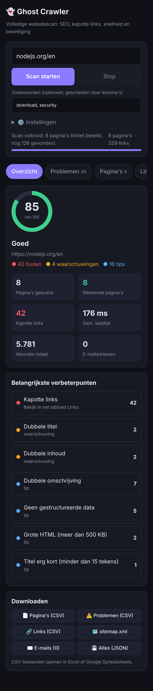

# 👻 Ghost Crawler

Een volledige websitescan die op je computer of telefoon draait. Je vult een website in en krijgt:

- een **score van 0 tot 100** met de belangrijkste verbeterpunten
- **SEO-controle**: titels, omschrijvingen, H1-koppen, dubbele inhoud, alt-teksten, noindex, canonical, Open Graph en gestructureerde data
- **kapotte links**: interne pagina's, externe links en bestanden (pdf en dergelijke)
- **snelheid**: laadtijd en grootte per pagina
- **beveiliging**: HTTPS, doorverwijzing, HSTS, CSP, clickjacking-bescherming en compressie
- **mobielvriendelijkheid**: controle op de viewport-tag
- **zoeken op woorden** over de hele site
- **sitemap.xml** van de site lezen, en er zelf een maken
- **export** naar CSV (Excel), JSON, sitemap.xml en een lijst met e-mailadressen

De scan loopt op de server, dus hij gaat door als je tussendoor van app wisselt of de pagina herlaadt.



## Op je Android-telefoon (Termux)

1. Installeer **Termux** via F-Droid: https://f-droid.org/packages/com.termux/
2. Plak dit in Termux:
   ```
   yes | pkg upgrade && pkg install -y nodejs git && git clone -b claude/wat-kan-je-nog-maken-2vgrv8 https://github.com/ghosttalk33-cell/Ghost.git && cd Ghost && node server.js
   ```
3. Open in je browser: **http://localhost:3000**

De volgende keer:
```
cd Ghost && git pull && node server.js
```

## Op een computer

Je hebt [Node.js](https://nodejs.org) 18 of nieuwer nodig.

```bash
node server.js
```

Open daarna **http://localhost:3000**.

## Waarom een server en geen los HTML-bestand?

Browsers blokkeren het ophalen van andere websites vanuit een HTML-pagina (CORS). Daarom haalt `server.js` de pagina's op en is `public/index.html` de bediening.

Crawl netjes en alleen sites waarvoor je toestemming hebt.
